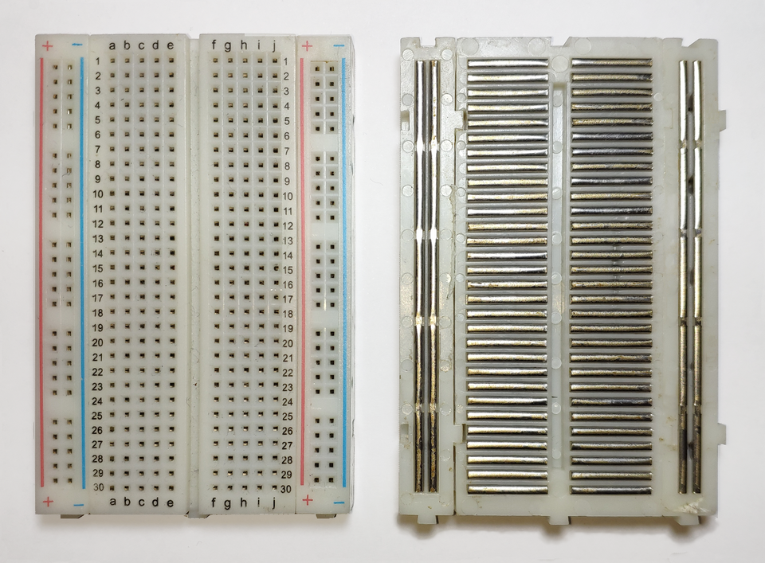
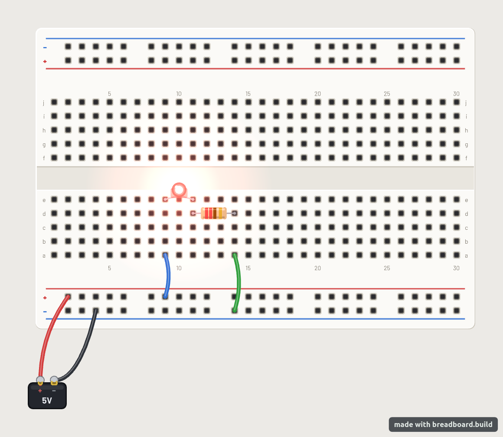

When building a circuit, we need a way to connect components and change those
connections easily. A **breadboard** lets us do this without soldering: we push
component legs and wires into holes instead of permanently joining them.

In this chapter, we'll learn how to:

- identify which holes are connected inside a breadboard
- use the power rails along its sides
- connect separate groups of holes with jumper wires

## Inside the board

The photograph below shows a breadboard from the front on the left, and with
its backing removed on the right.

Under the plastic surface are metal strips. Each strip grips the legs or wires
pushed into its holes and connects them electrically. Two legs inserted into
holes on the same strip are connected, just as if we had joined them with a
wire.

The important question is therefore not how close two holes are, but whether
they share a metal strip.

## Groups of five

Look at the numbered rows in the middle of the board. The letters across the
top identify the columns. On this board, each metal strip connects five holes:

- `a1`, `b1`, `c1`, `d1` and `e1` are connected.
- `f1`, `g1`, `h1`, `i1` and `j1` are connected to one another, but not to `a1`–`e1`.
- Row 2 has its own two groups of five, separate from row 1.

The same pattern repeats down the board. For example, a component leg in `a8`
and a wire in `d8` are connected. Moving the wire to `d9` breaks that connection.

The **centre gap** separates the two groups on each numbered row. There is no
metal strip running across it: `e8` and `f8` are next to each other, but they
are not connected.

## Power rails

The long columns of holes along the sides are called **power rails**. Unlike
the groups of five in the middle, their metal strips run along the length of
the board. They let us make a power connection available at several points
in a circuit.

The red line and `+` label mark a rail normally used for the positive supply.
The blue line and `−` label mark a rail normally used for ground (`GND`), the
circuit's reference connection. Each rail is separate from the other rails
and from the groups of five in the middle.

The labels do not supply power. A rail only becomes connected to a supply or
ground when we wire it to that connection on a power source.

::: {.callout-note}
Some breadboards have a break halfway along their power rails, making each
rail two separate sections. Do not assume that every hole beside a coloured
line is connected. Check the board's documentation or use a multimeter's
continuity mode to check whether the sections are connected.
:::

## Joining separate groups

A **jumper wire** is a wire used to connect two points in a circuit. Its bare
ends fit into the breadboard's holes.

Suppose we put one end of a jumper wire in `e1` and the other in `a5`. Before
adding the wire, `a1`–`e1` and `a5`–`e5` are separate groups. With the wire in
place, all ten holes are electrically connected. The wire joins the two metal
strips; it does not connect any of the rows in between.

We can use a jumper wire in the same way to connect a power rail to a group
of five. Components in that group then share the rail's connection.

## Following a connection through a circuit

The diagram below shows an LED and a resistor connected to a power source on
a breadboard. The resistor limits the current through the LED. For now, look
at how the breadboard connects the parts.

This breadboard is turned sideways compared with the earlier photograph.
The numbered rows now run from top to bottom on the page, but the rule is the
same: `a`–`e` at each number are connected.

The red and black wires connect the power source to the lower `+` and `−`
rails. From there, we can trace the circuit:

- The blue jumper connects the `+` rail to `a9`. The LED's first leg is in
  `e9`, so the strip for row 9 connects the jumper to the LED.
- The LED's other leg is in `e11`. One end of the resistor is in `d11`, so
  the strip for row 11 connects the LED to the resistor.
- The resistor's other end is in `d14`. The green jumper is in `a14`, so
  the strip for row 14 connects the resistor to the jumper. The jumper's
  other end connects to the `−` rail.

The complete path is **`+` rail → blue jumper → LED → resistor → green
jumper → `−` rail**. The metal strips make the connections between parts
that do not touch each other directly.

Notice that the LED's legs are in separate numbered rows. If both legs were
in the same group of five, the metal strip would join them directly,
bypassing the LED.

## Summary

A breadboard connects holes through hidden metal strips; jumper wires join
separate strips.

| Part | Connection rule |
|---|---|
| Groups of five | On each numbered row, `a`–`e` share one strip and `f`–`j` share another. Different numbered rows are separate. |
| Centre gap | The groups on opposite sides of the gap are not connected. |
| Power rails | Holes along each continuous rail section are connected. Separate rails and split sections need wires to join them. |
| Power labels | `+` and `−` mark intended uses; a rail needs a wire to a power source before it supplies power. |
| Jumper wire | Connects the strips containing its two ends, including every hole on those strips. |
