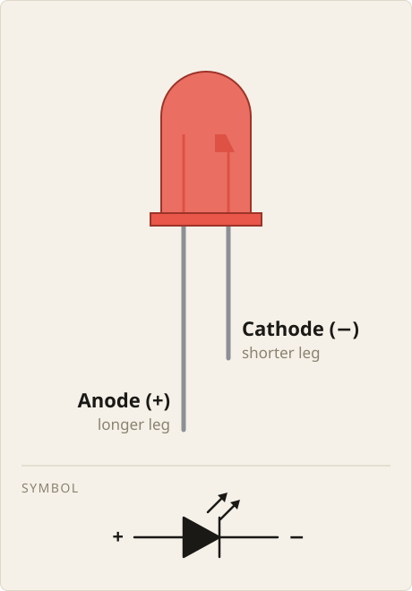
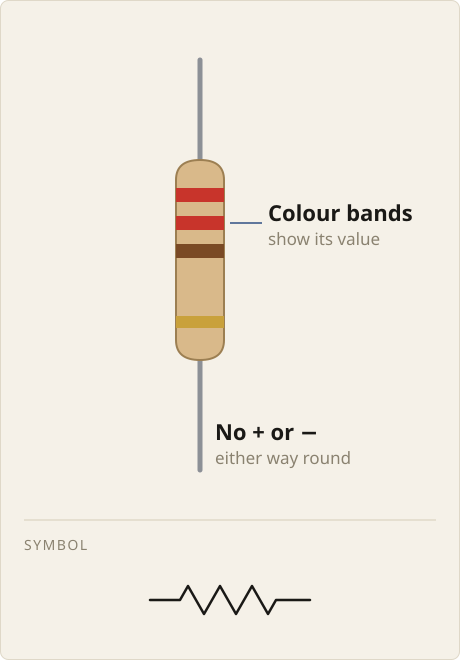

We often need a small light to show whether a device is on or a program has
reached a particular point. An **LED** (Light-Emitting Diode) provides that
light, with a resistor to limit the current through it.

In this chapter, we'll learn how to:

- identify the two legs of an LED
- explain why an LED needs a resistor
- recognise a resistor connected in series with an LED

## Which leg is which?

An LED produces light when electric current flows through it in its forward
direction. Its two legs have different jobs:

- The **anode** connects towards the positive side of the supply.
- The **cathode** connects towards the negative side of the supply.

On a new, uncut LED, the anode is the longer leg and the cathode is the
shorter leg.

{width=360}

In a circuit diagram, we draw the LED using the symbol shown below the
component. The bar marks the cathode side; the two arrows pointing away
represent the light it emits.

Many round LEDs also have a flat edge on the rim beside the cathode. This
helps identify it after the legs have been trimmed. If the markings are
unclear, check the component's documentation rather than guessing.

An LED has **polarity**: which way round we connect it matters. Connected
backwards in our low-voltage circuit, it will not light.

## Limiting the current

**Current** is the flow of electric charge through a circuit. An LED needs
current to produce light, but too much current can damage it. Connected
directly across a power supply, an LED does not keep the current at a safe
level by itself.

A **resistor** opposes the flow of current. We put one in the LED's path to
limit the current through it.

{width=360}

The resistor's coloured bands show its resistance value. In a circuit
diagram, we represent the resistor with a zigzag line.

::: {.callout-warning}
Always use a current-limiting resistor with the LEDs in these circuits.
Connecting an LED directly across a power source can damage the LED.
:::

Resistance is measured in **ohms**, written `Ω`. For example, `330 Ω` means
330 ohms. In the same LED circuit, a larger resistance gives less current
and usually a dimmer light. A smaller resistance allows more current; too
small a value can let through enough to damage the LED.

For a typical small red indicator LED powered from 5 V, `330 Ω` is a
reasonable starting value. The right value depends on the supply voltage
and the LED's ratings; it is not the same for every LED circuit.

A resistor has no polarity. Either end can face the positive supply.

## One path through both parts

The resistor must be **in series** with the LED: the current has to pass
through both parts along the same path.

For example, this is a series connection, with the LED's anode facing the
positive supply:

```text
Supply + → resistor → LED → supply −
```

Here, `+` and `−` are the power source's positive and negative terminals.
We can also put the resistor on the other side of the LED:

```text
Supply + → LED → resistor → supply −
```

Both arrangements limit the current through the LED. The resistor does not
have to come "before" the LED; it has to share the same current path.

On a breadboard, one LED leg and one resistor leg can share a group of five
holes to make their connection. The LED's other leg must go in a separate
group, as must the resistor's other leg. Putting both ends of either part
in one connected group would let current bypass that part through the metal
strip.

In the next chapter, we'll build this circuit on a breadboard and connect
it to a power source.

## Summary

An LED needs the correct polarity and a resistor in series to limit its
current.

| Part or term | Rule |
|---|---|
| LED | Produces light when current flows in its forward direction. |
| Anode | The longer leg on an uncut LED; connects towards the positive supply. |
| Cathode | The shorter leg on an uncut LED, often marked by a flat edge on the rim; connects towards the negative supply terminal. |
| Resistor | Limits current; either way round works. |
| Resistance | Measured in ohms (`Ω`); a larger value gives less current in the same LED circuit. |
| In series | The LED and resistor share one current path; the resistor can be on either side of the LED. |
