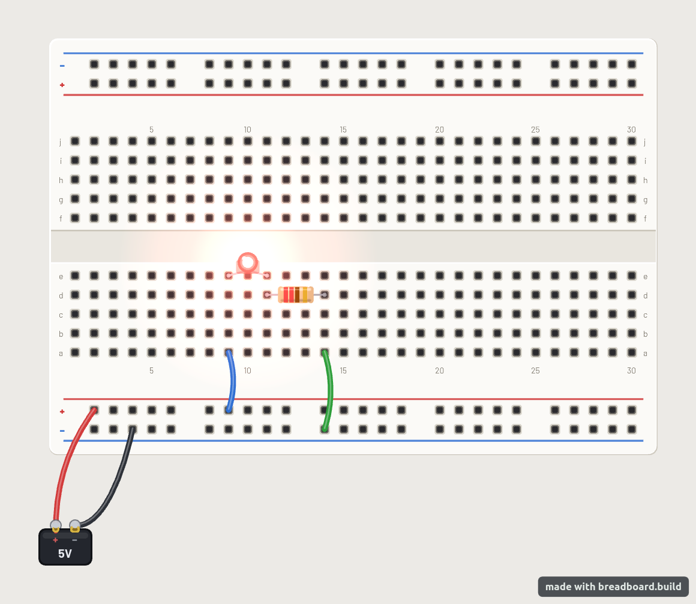
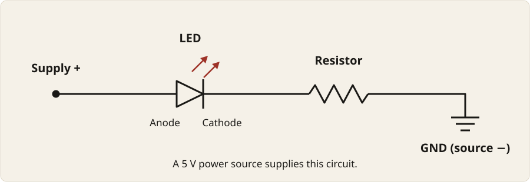
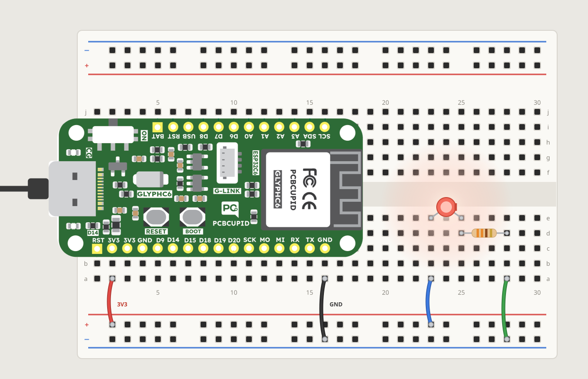

To light an LED, we need a complete path from a power supply through the LED
and a resistor, and back to the supply. A battery or another low-voltage
**power source** provides the positive and negative terminals for this circuit.

In this chapter, we'll learn how to:

- read a circuit diagram for an LED and resistor
- build the circuit on a breadboard
- connect a power source and light the LED

## From a layout to a circuit diagram

Here is the breadboard example we saw earlier. The red and black wires
connect the power source to the rails. The blue and green jumper wires
connect those rails to the LED and resistor.



This picture shows a **5 V** power source. Its positive terminal connects
to the `+` rail, and its negative terminal connects to the `−` rail.

A **circuit diagram**, also called a **schematic**, shows the electrical
connections rather than the physical positions of the parts. Here is the
same circuit without the breadboard:



The straight lines represent electrical connections. A line can stand for a
wire, a breadboard strip, or both. The LED symbol has a bar on its cathode
side; the two arrows pointing away represent the light it emits. The
zigzag represents the resistor. The ground symbol marks the connection
back to the power source's negative terminal, not a separate component we
need to add. Here, we use that terminal as **ground** (`GND`), the circuit's
voltage reference.

Follow the path from left to right: supply positive → LED anode → LED
cathode → resistor → ground. There is only one path, so the LED and resistor
are in series. In this circuit, the resistor comes after the LED, just as
it does in the breadboard picture.

## Wiring the breadboard

Use a small red indicator LED, a **330 Ω resistor**, and jumper wires. This
resistor value is suitable for a typical small red LED with the 5 V supply
shown here.

::: {.callout-warning}
Disconnect the power source before adding or moving wires. Never connect
its positive and negative terminals directly: that is a **short circuit**,
a path that can draw too much current and heat the wires or damage the
source. Keep the resistor in series with the LED.
:::

Use the labels in the breadboard picture to place the parts:

1. Put the LED's **anode** (longer leg) in `e9` and its **cathode** (shorter
   leg) in `e11`.
2. Put one end of the resistor in `d11` and the other in `d14`. The strip
   connecting `d11` to `e11` joins the resistor to the LED's cathode.
3. Connect the lower `+` rail to `a9` with a jumper wire, shown in blue.
   The strip connecting `a9` to `e9` joins the rail to the LED's anode.
4. Connect `a14` to the lower `−` rail with a jumper wire, shown in green.
   The strip connecting `d14` to `a14` joins the resistor to that rail.
5. Prepare a wire from the lower `+` rail to the power source's positive
   terminal and another from the lower `−` rail to its negative terminal.
   Leave the power source disconnected while checking the wiring.

Before connecting the power source, trace the whole path once:

```text
Source + → + rail → LED anode → LED cathode → resistor → − rail → source −
```

The LED's legs must be in separate groups of holes. The resistor's ends
must also be in separate groups, so that no metal strip bypasses it.

## Powering the LED

Connect the power source's positive terminal to the `+` rail and its
negative terminal to the `−` rail. The LED should light and stay on until
we disconnect the source. No program is involved: the power source supplies
the current through the LED and resistor.

If the LED stays dark, disconnect the power source before checking the circuit. Check that
the anode faces the `+` rail, that the resistor shares a strip with the
cathode, and that both supply wires reach the rails used by the jumpers.
On a board with split power rails, the supply wire and its jumper must use
the same connected section, or the sections need a wire joining them.

## Using the board as the power source

We don't have a battery, so we use our Glyph C6 board as the power source
instead. Its 3V3 pin connects to the `+` rail, and a GND pin connects to the
`−` rail:


The board sits at the left end, across the centre gap, with its pins in rows
`c` and `i`. Its first pin is in column 1, so no columns are left empty. Each
pin is in its own group of five, so a jumper wire in row `a` connects to the
pin above it:

1. Connect `a2`, below the first 3V3 pin, to the lower `+` rail with a red
   jumper wire.
2. Connect `a16`, below the last GND pin, to the lower `−` rail with a black
   jumper wire.

The board gets its power from the USB cable, so unplug the cable before
adding or moving wires.

3V3 supplies 3.3 volts whenever the board has power, so the `+` rail has
3.3 volts as soon as the USB cable is plugged in. No program is involved.

## Adding the LED and resistor

The board covers columns 1 to 18, so the LED and resistor go in the free
columns to its right. They are wired the same way as before, moved along the
board:



1. Put the LED's anode (longer leg) in `e23` and its cathode (shorter leg) in
   `e25`.
2. Put one end of the resistor in `d25` and the other in `d28`.
3. Connect the lower `+` rail to `a23` with a jumper wire, shown in blue.
4. Connect `a28` to the lower `−` rail with a jumper wire, shown in green.

Trace the path before plugging in the USB cable:

```text
3V3 → + rail → LED anode → LED cathode → resistor → − rail → GND
```

Plug in the cable, and the LED lights. The 330 Ω resistor works here too;
with 3.3 volts instead of 5, less current flows, and the LED is dimmer than
with the 5 V source.

## Summary

An LED lights when it has a complete path from the power source's positive
terminal through the LED and a series resistor to its negative terminal.

| Part or connection | Role in this circuit |
|---|---|
| Source positive → `+` rail | Connects the power source's positive terminal to the breadboard. |
| `+` rail → LED anode | Connects the positive supply to the LED's longer leg. |
| LED cathode → resistor | Connects the LED's shorter leg to the current-limiting resistor. |
| Resistor → `−` rail → source negative | Completes the path back to the power source. |
| Board as the power source | 3V3 → `+` rail and GND → `−` rail; the rail has 3.3 V whenever the board is plugged in. |
| Circuit diagram | Shows electrical connections; physical positions and wire colours can differ. |
| Changing connections | Disconnect the source first; keep the resistor in series and never join the source's terminals directly. |
