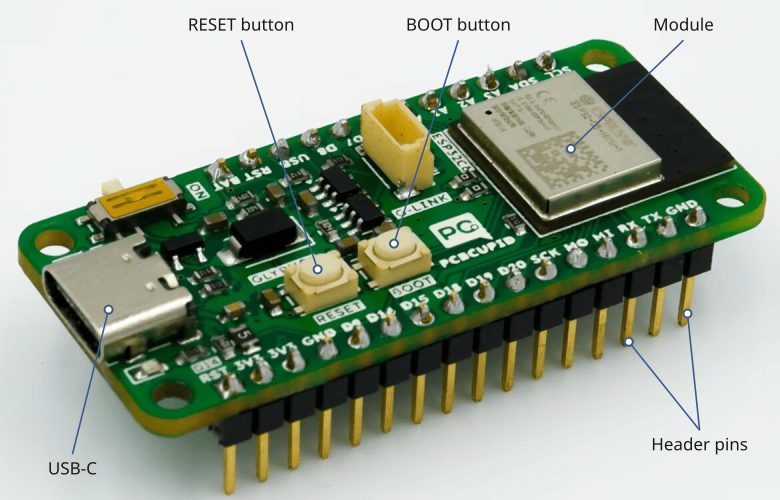
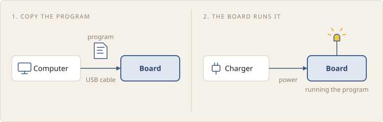

A microcontroller chip is too small to wire by hand, and it cannot be
programmed until it is powered and connected to a computer. A development
board is a small circuit board that does this for us: it holds the chip, powers
it, connects it to a computer, and brings its pins out to the edges of the
board, where we can connect wires.

## The Glyph C6

In this course, we use a development board called the Glyph C6. Its
microcontroller is an ESP32-C6, made by Espressif. ESP32 is a family of
microcontrollers, and the ESP32-C6 is one of them.

The board has these main parts:

- **Module.** The ESP32-C6 chip sits under the metal cover, along with the
  memory that stores our programs. Together, they are called a module. The
  black strip at its end is an antenna for Wi-Fi and Bluetooth.
- **USB-C connector.** A USB cable powers the board and connects it to the
  computer.
- **Header pins.** A row of header pins runs along each long edge, ready to
  plug into a breadboard. Some are connected to the chip's pins, and others
  supply power. The label printed beside each pin gives its name.
- **RESET button.** Restarts the microcontroller.
- **BOOT button.** Held down while the board is plugged in, it puts the board
  into a mode where new software, such as MicroPython, can be installed on it.

The board has a few more parts, such as a switch for a battery. We will not
use them.

## Running a program on the board

We write a program for the microcontroller on a computer. To run it, we
connect the board to the computer with a USB cable and copy the program to the
board. The program is stored in the module's memory, which keeps it even when
the power is off.

The microcontroller then runs the program on its own. The board no longer needs
the computer: we can unplug it, power it from a phone charger or a battery, and
it runs the program as soon as it is switched on. This is how microcontrollers
work in devices: the program is copied to the microcontroller when the device
is made, and the device runs it from then on.

In later lessons, we'll learn how to write a program for the board and copy it
there.

## Summary

A development board holds a microcontroller chip and makes it easy to use: we
copy a program to it from a computer, and the microcontroller then runs the
program on its own, without the computer.

| Part            | What it does |
|-----------------|--------------|
| Module          | holds the microcontroller chip, its memory and an antenna |
| USB-C connector | powers the board, and connects it to the computer to copy programs to it |
| Header pins     | connect the chip, and power, to the components we wire up |
| RESET button    | restarts the microcontroller |
| BOOT button     | puts the board into a mode for installing software such as MicroPython |
