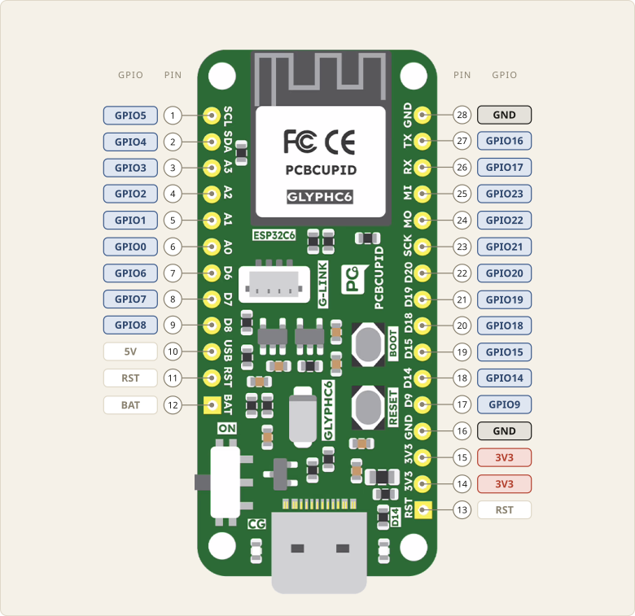

Before we connect a wire to a board, we need to know what each of its pins
does. A pinout diagram shows this: it is a map of the board's pins, with the
names and numbers of each one.

## Reading the diagram

The diagram labels each pin with two numbers:

- **The physical pin number**, in the circle. It is the pin's position on the
  board. Pins 1 to 12 run up the right edge, and pins 13 to 28 run down the
  left edge.
- **The GPIO number**, in the blue label, such as GPIO14. We'll see what it
  means in a moment.

The photo also shows the label printed on the board beside each pin. For
example, the pin labelled D14 is physical pin 18, and its GPIO number is 14.

## Power pins

Some pins supply power to the components we connect:

- **3V3** supplies 3.3 volts. Pins 14 and 15.
- **GND**, or ground, is 0 volts. Current that flows out of the board through a
  circuit returns to it through GND. Pins 16 and 28.

The board gets its own power from the USB cable, and we use 3V3 and GND to
power our circuits. We will not use the pins in white.

## GPIO pins

The pins that a program can read, or switch on and off, are called GPIO pins.
GPIO stands for General-Purpose Input/Output. A GPIO pin can work in either of
two ways:

- **Input.** The program reads a signal on the pin, such as whether a button is
  pressed.
- **Output.** The program sets a signal on the pin, such as the voltage that
  turns an LED on or off.

When we write a program, we refer to a pin by its GPIO number. In MicroPython,
`Pin(14)` means GPIO14. It does not mean physical pin 14, which is a 3V3 pin.

## The numbers depend on the board

GPIO numbers belong to the chip. The company that makes the board decides which
GPIO pin goes to which header pin, and what label to print beside it. On the
Glyph C6, the numbers in most labels match the GPIO numbers: D14 is GPIO14, and
A0 is GPIO0.

On another board, this is not always so. Even with the same ESP32-C6 chip, the
pin labelled D14 may connect to a different GPIO pin, or the board may have no
D14 at all. A different microcontroller has a different set of GPIO pins
altogether.

::: {.callout-warning}
Always use the pinout diagram for the exact board in front of you. With the
diagram for another board, a wire can end up on the wrong pin, and the program
fails without any error: the LED simply does not light.
:::

## Summary

A pinout diagram shows what each pin of a board does, and a program refers to
a pin by its GPIO number, which only the pinout of that exact board can tell
us.

| Term                | Meaning |
|---------------------|---------|
| Pinout diagram      | a map of a board's pins, with the names and numbers of each |
| Physical pin number | the pin's position on the edge of the board |
| GPIO pin            | a pin a program can read (input), or switch on and off (output) |
| GPIO number         | the number a program uses for a pin: `Pin(14)` is GPIO14, not physical pin 14 |
| 3V3                 | supplies 3.3 volts |
| GND                 | ground, 0 volts: current returns to the board through it |
