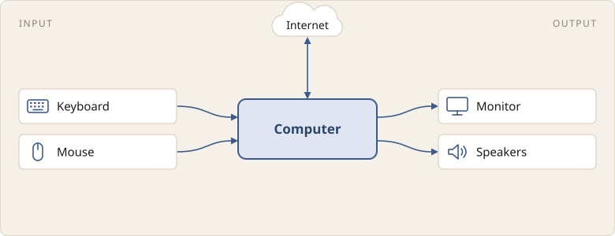
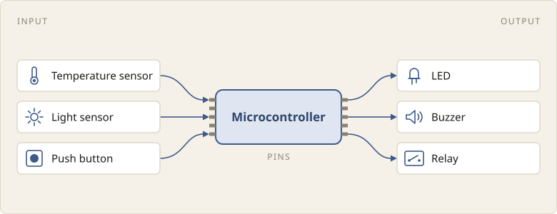

A microcontroller is a small computer built into a single chip, designed to
control devices.

## Computers and microcontrollers

Computers are designed primarily for people. A computer is connected to a
keyboard, a mouse and a monitor, and people interact with it through them.

A microcontroller, on the other hand, is designed primarily to control devices.
It has pins: metal contacts that wires connect to. Through its pins, it is
connected to components that sense things, and to the devices it controls. A
program running on the microcontroller can read a pin, or switch it on and off.

Components that sense things, such as a temperature sensor or a push button,
are called sensors. Components that act on a signal from the microcontroller,
such as an LED, a buzzer or a relay, are called actuators. A relay is a switch
that the microcontroller turns on and off, and it can in turn switch a fan or a
water pump.

Microcontrollers are small and cheap, so they are built into the devices they
control: a fan, a washing machine, a water pump.

## Summary

A microcontroller is a small computer designed to control devices: through its
pins, it reads sensors and controls actuators.

| Term            | Meaning |
|-----------------|---------|
| Microcontroller | a small computer on a single chip, designed to control devices |
| Pin             | a metal contact that a wire connects to; a program can read it, or switch it on and off |
| Sensor          | a component that senses something: temperature, light, a button press |
| Actuator        | a component that acts on a signal from the microcontroller: an LED, a buzzer, a relay |
