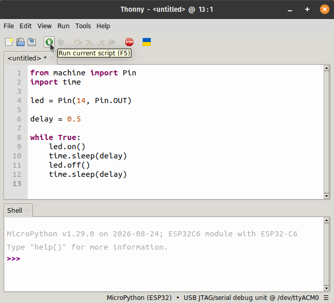

Typing commands in the REPL one at a time is fine for trying things out, but a
board usually has to do something over and over, without us. For this, we write
a program in Thonny's editor, and run it on the board with the Run button.

In this chapter, we'll learn how to:

- write a program that blinks the board's LED
- run it on the board, and stop it

## Writing the program

Connect Thonny to the board, and type this program in the editor, the large
area at the top of Thonny's window:

```python
from machine import Pin
import time

led = Pin(14, Pin.OUT)

delay = 0.5

while True:
    led.on()
    time.sleep(delay)
    led.off()
    time.sleep(delay)
```

The first lines set up GPIO14 as an output, as we did in the REPL. The rest is
new:

- `delay` is the time, in seconds, that the LED stays on, and then off.
- `time.sleep(delay)` waits that long before the next line runs. It comes from
  the `time` module, which the program imports at the top.
- `while True:` repeats the lines indented under it, again and again, forever.

Each time round the loop, the LED is on for half a second, then off for half a
second.

## Running the program

Click the green **Run** button in the toolbar.



Thonny sends the program to the board, and the board runs it. The LED blinks.

The program never ends on its own, because `while True:` never stops. To stop
it, click the red **Stop** button in the toolbar. Thonny restarts MicroPython
on the board, which is called a soft reboot, and the shell shows:

```session
MPY: soft reboot
MicroPython v1.29.0 on 2026-08-24; ESP32C6 module with ESP32-C6
Type "help()" for more information.
>>>
```

The restart clears everything the program set up, so `led` no longer exists.
To use the LED from the REPL again, set up the pin again.

::: {.callout-note}
Stop the program, change `delay` to `0.1`, and click Run again. The LED blinks
five times faster. Because the delay is set in one place, one change is enough.
:::

## Summary

A program in Thonny's editor runs on the board when we click Run, and a
`while True:` loop keeps it running until we click Stop.

| Code or button      | What it does |
|---------------------|--------------|
| **Run** (green)     | runs the program in the editor on the board |
| **Stop** (red)      | stops the program with a soft reboot, and returns to the `>>>` prompt |
| `import time`       | makes the `time` module available |
| `time.sleep(delay)` | waits `delay` seconds before the next line runs |
| `while True:`       | repeats the lines indented under it forever |
