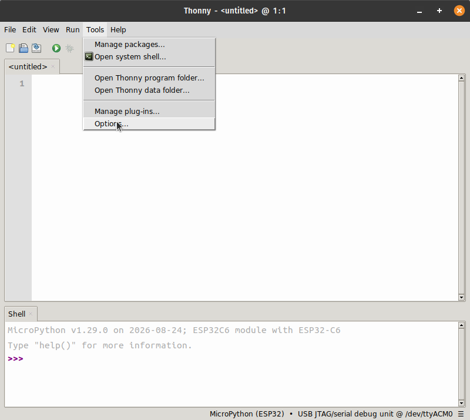
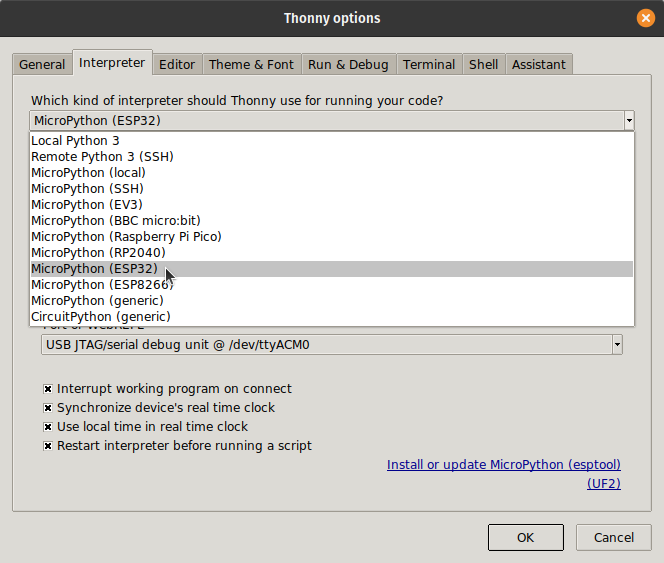
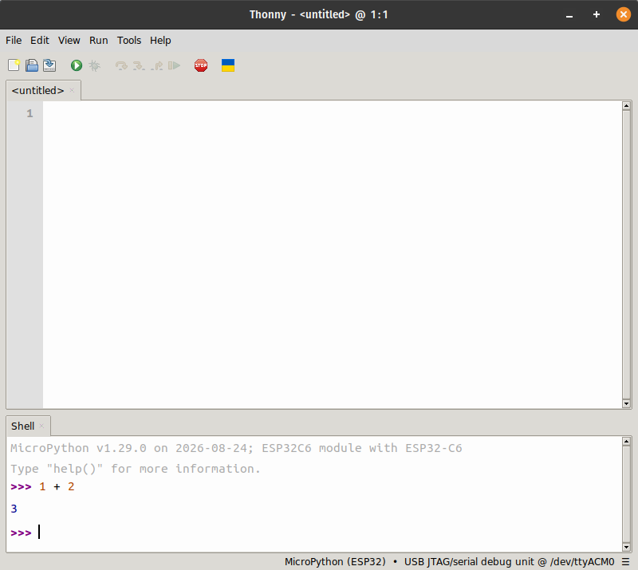

To run Python on a microcontroller, we need a version of Python small enough
to fit in its memory. MicroPython is that version, and our boards have it
installed.

In this chapter, we'll learn how to:

- connect Thonny to the board
- run Python commands on the board

## Connecting Thonny to the board

Plug the board into the laptop with the USB cable, and open Thonny. Then:

1. Open the **Tools** menu, and choose **Options**.

   {fig-alt="Thonny's Tools menu, with Options selected."}

2. In the **Interpreter** tab, under **Which kind of interpreter should Thonny
   use for running your code?**, choose **MicroPython (ESP32)**.

   {fig-alt="The Interpreter tab of Thonny's options, with MicroPython (ESP32) chosen from the list."}

3. Below it, choose the board's port, or leave it on **Try to detect port
   automatically**.
4. Click **OK**.

Thonny connects to the board, and the shell shows MicroPython's welcome
message, followed by the `>>>` prompt. This is MicroPython's REPL: what we type
in the shell now runs on the board, not on the laptop.



The bottom-right corner of Thonny's window shows the interpreter it is using,
and the port of the board. Clicking it is a quicker way to switch between
Python on the laptop and MicroPython on the board.

::: {.callout-warning}
On Linux, Thonny may not be allowed to use the board's port, and it reports
that it cannot connect. Add yourself to the `dialout` group, which is allowed
to use it:

```session
$ sudo usermod -aG dialout $USER
```

Then log out and log in again. The change takes effect only in a new login.
:::

## Running commands on the board

Type these in the shell, pressing Enter after each:

```session
>>> 2 + 3
5
>>> 7 * 6
42
>>> 2 ** 10
1024
```

They look just like Python on the laptop. To check where they ran, ask Python
which platform it is running on:

```session
>>> import sys
>>> sys.platform
'esp32'
```

The answer is `esp32`: the board did the calculation, and the laptop only
showed us the result. In Python on the laptop, the same command gives
`'win32'`, `'linux'` or `'darwin'`.

## Summary

MicroPython is Python for microcontrollers, and once Thonny is connected to
the board, every command we type in its shell runs on the board.

| Step                 | How |
|----------------------|-----|
| Connect to the board | **Tools** → **Options** → **Interpreter** → **MicroPython (ESP32)**, and the board's port |
| Switch interpreter   | click the bottom-right corner of Thonny's window |
| Check where it runs  | `import sys` then `sys.platform`: `'esp32'` on the board |
| Linux port access    | `sudo usermod -aG dialout $USER`, then log in again |
