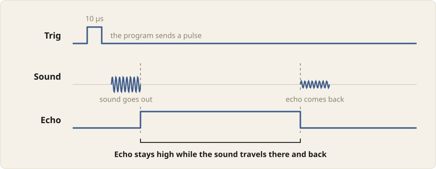

A program often needs to know how far away something is. An **ultrasonic
sensor** measures this: it sends out a short burst of sound, too high for us
to hear, and times how long the echo takes to come back.

In this chapter, we'll learn how to:

- connect an HC-SR04 ultrasonic sensor to the board
- measure how long a pin stays on
- print the distance to an object
- blink an LED when an object comes too close

## The HC-SR04

The HC-SR04 has two round **transducers** on its front. The one marked T
sends the sound out, and the one marked R picks up the echo. It has four
pins:

| Pin  | Connects to    | What it does |
|------|----------------|--------------|
| Vcc  | 3V3            | powers the sensor |
| Trig | a GPIO output  | starts a measurement |
| Echo | a GPIO input   | tells how long the echo took to come back |
| Gnd  | GND            | completes the circuit |

A measurement goes like this:

1. The program turns Trig on for 10 microseconds. A microsecond, written µs,
   is a millionth of a second.
2. The sensor sends out a burst of sound, at 40,000 vibrations a second. We
   hear up to about 20,000.
3. As soon as the burst has gone out, the sensor turns Echo on.
4. When the echo comes back, the sensor turns Echo off.



So the time Echo stays on is the time the sound took to reach the object and
come back. Sound travels about 343 metres a second, which is 0.0343
centimetres every microsecond. If Echo stays on for `t` microseconds, the
sound travelled `t × 0.0343` centimetres, there and back, and the object is
half that far away:

```text
distance = t × 0.0343 / 2  ≈  t / 58
```

For example, if Echo stays on for 580 µs, the object is 10 cm away. The
sensor measures from about 2 cm to about 4 metres.

::: {.callout-warning}
Our sensor works at 3.3 volts. Some HC-SR04 sensors need 5 volts, and their
Echo pin then gives out 5 volts, more than the board's pins can take. Check
that your sensor works at 3.3 volts before you connect it this way.
:::

## Connecting the sensor

The sensor needs more room than the breadboards we have used so far, so we
use a full-length breadboard, with 60 columns instead of 30. Build the
circuit that blinks an LED from D15 on it, in the same holes. Unplug the USB
cable. Then:

1. Push the sensor's pins into `e44` to `e47`, with Vcc in `e44` and Gnd in
   `e47`. The transducers face the near edge of the breadboard, the one with
   row `a`.
2. Connect `a44` to the `+` rail with a red jumper wire. This gives Vcc 3.3
   volts.
3. Connect `a47` to the `−` rail with a black jumper wire. This connects Gnd
   to GND.
4. Connect `a9`, below D19, to `c45` with an orange jumper wire. This
   connects GPIO19 to Trig.
5. Connect `a8`, below D18, to `c46` with a blue jumper wire. This connects
   Echo to GPIO18.


The two wires from the board go in different directions. Trig is an output:
the program sets it, and the sensor reads it. Echo is an input: the sensor
sets it, and the program reads it.

## Printing the distance

In the earlier chapters, we tried out each new pin in the REPL first. That
does not work here: the echo comes back within a few thousandths of a
second, long before we can type the next line. So we write the program in
the editor straight away.

Plug in the USB cable, connect Thonny to the board, and type this program:

```python
from machine import Pin, time_pulse_us
import time

trig = Pin(19, Pin.OUT)
echo = Pin(18, Pin.IN)

while True:
    trig.on()
    time.sleep_us(10)
    trig.off()
    duration = time_pulse_us(echo, 1, 30000)
    if duration < 0:
        print("nothing in range")
    else:
        print(round(duration / 58), "cm")
    time.sleep(0.5)
```

`Pin(18, Pin.IN)` sets up GPIO18 as an input, so the program can read it.
`time.sleep_us(10)` waits for 10 microseconds, which gives the 10 µs pulse
on Trig.

`time_pulse_us(echo, 1, 30000)` waits for Echo to turn on (`1`), measures how
long it stays on, and returns that time in microseconds. If Echo does not
turn on, or stays on, for 30,000 µs, it gives up and returns a negative
number instead. 30,000 µs is enough for sound to go about 5 metres and back,
further than the sensor can measure.

Click Run, and hold a hand in front of the sensor. The program prints the
distance to it twice a second. Move the hand closer and further away, and
watch the numbers change. A reading can jump by a centimetre or so even
with the hand still. Soft things such as clothes soak up some of the sound,
so they are harder to measure than a hand or a book.

## Blinking when too close

To make the board warn us when something is too close, the program compares
each distance with a limit, and blinks the LED on D15 while the distance is
below it. Type this program in the editor:

```python
from machine import Pin, time_pulse_us
import time

led = Pin(15, Pin.OUT)
trig = Pin(19, Pin.OUT)
echo = Pin(18, Pin.IN)

limit = 10

while True:
    trig.on()
    time.sleep_us(10)
    trig.off()
    duration = time_pulse_us(echo, 1, 30000)
    distance = duration / 58
    if duration > 0 and distance < limit:
        led.on()
        time.sleep(0.1)
        led.off()
        time.sleep(0.1)
    else:
        led.off()
        time.sleep(0.2)
```

`limit` is the distance in centimetres below which the LED blinks. The check
`duration > 0` matters: when nothing is in range, `duration` is negative, so
`distance` is negative too, and a negative number is less than 10. Without
the check, the LED would blink when there is nothing in front of the sensor
at all.

Click Run. With nothing near the sensor, the LED stays off. Bring a hand
closer than 10 cm, and the LED starts to blink. Each time round, the loop
takes 0.2 seconds, either blinking once or waiting, so the program measures
the distance five times a second.

## Summary

An ultrasonic sensor measures distance by timing an echo, and a program
turns that time into a distance.

| Connection or code | What it does |
|--------------------|--------------|
| Vcc → 3V3, Gnd → GND | powers the sensor |
| D19 → Trig | lets the program start a measurement |
| Echo → D18 | lets the program read how long the echo took |
| `echo = Pin(18, Pin.IN)` | sets up GPIO18 as an input |
| `time.sleep_us(10)` | waits for 10 microseconds |
| `time_pulse_us(echo, 1, 30000)` | returns how long Echo stays on, in µs, or a negative number if it times out |
| `duration / 58` | turns the time into a distance in centimetres |
| `if duration > 0 and distance < limit:` | is true only for a real reading closer than the limit |
